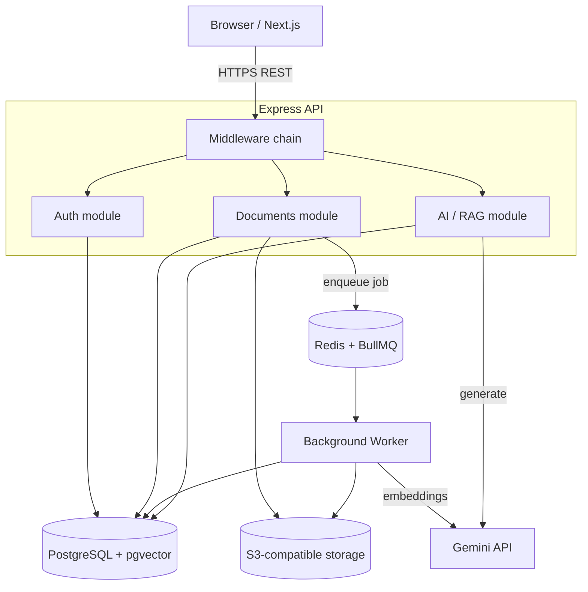
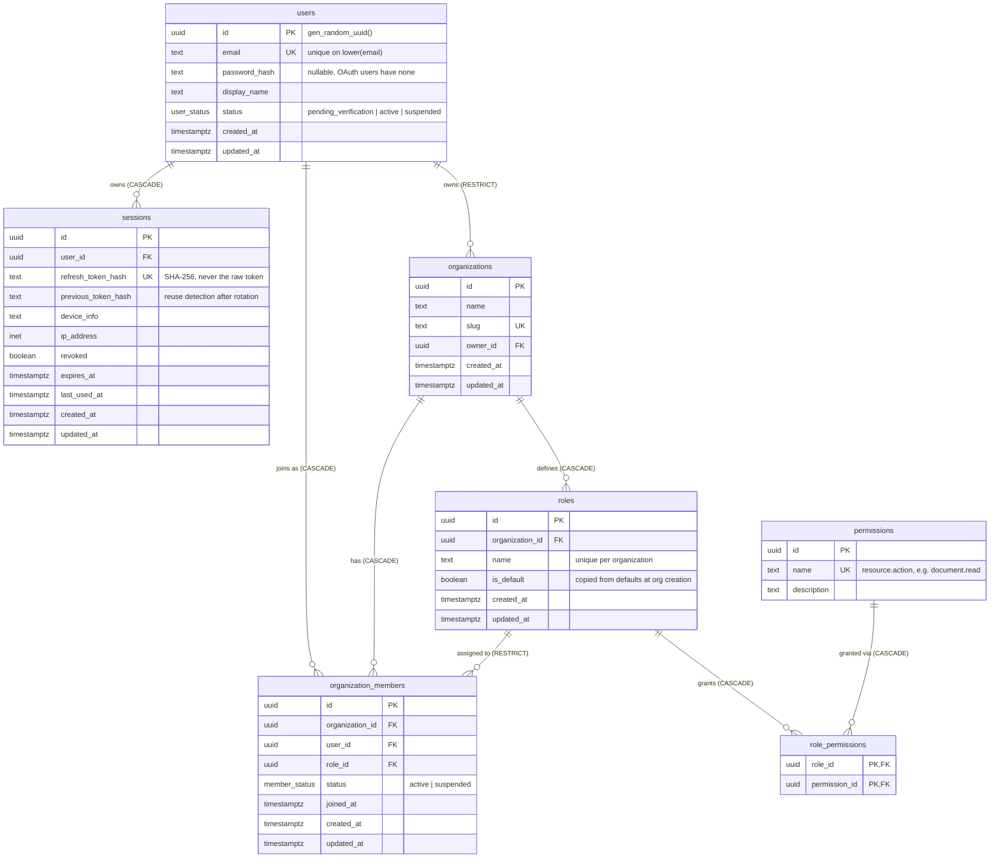
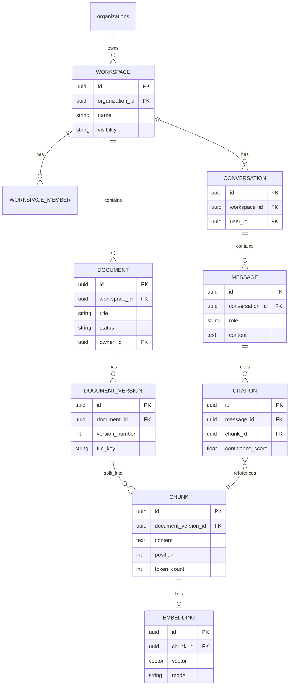
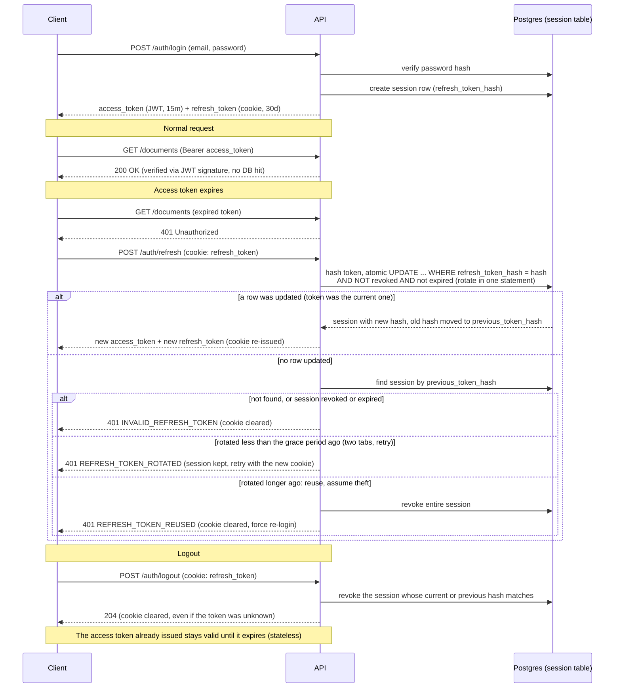
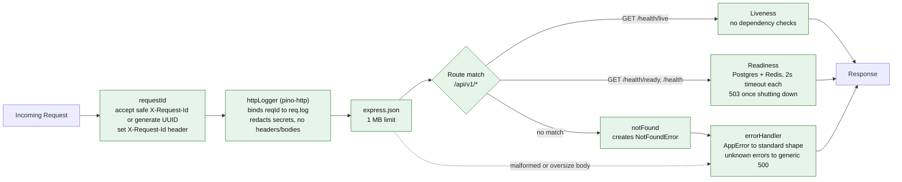
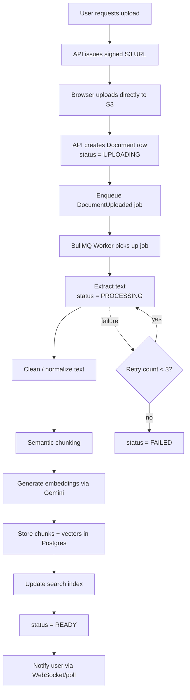
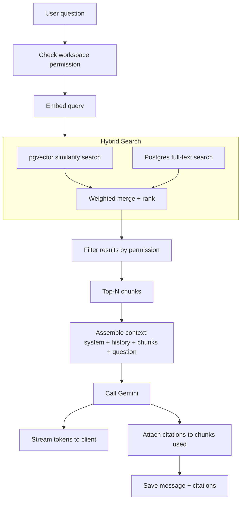

# Atlas — Architecture Diagrams (MVP Scope)

Scope: Phase 0–3 (foundation, auth, knowledge ingestion, RAG chat). Update these as you build — they should reflect what the code actually does, not the aspirational doc.

**Status legend:** diagrams 2 and 4 are split into **Implemented** (matches the code on `main`) and **Planned** (not built yet). Last verified against code: 2026-10-28.

---

## 1. System Overview



---

## 2. Data Model — ER Diagram

### 2a. Implemented: identity domain (migrations `0000`–`0001`)

Source of truth: `apps/api/src/db/schema/identity.ts`. Table names are plural (`user` is a reserved word in Postgres). Relationship labels show the foreign key's `ON DELETE` behavior.



Constraints and indexes not visible in the diagram:

| Table | Constraint / index | Why |
|---|---|---|
| `users` | unique index on `lower(email)` | `A@x.com` and `a@x.com` are one account; lookups must use `lower(email) = $1` |
| `sessions` | unique `refresh_token_hash`; indexes on `previous_token_hash`, `user_id`, `expires_at` | refresh lookup, reuse detection, "revoke all my sessions", expired-session cleanup |
| `organization_members` | unique `(organization_id, user_id)`; indexes on `user_id`, `role_id` | one membership per org; "which orgs is this user in" |
| `roles` | unique `(organization_id, name)` | role names are unique within an organization |
| `role_permissions` | composite PK `(role_id, permission_id)`; index on `permission_id` | no duplicate grants; "which roles have permission X" |

`ON DELETE` summary: **CASCADE** where a child has no meaning without its parent (sessions, memberships, roles, join rows). **RESTRICT** where deletion must be a conscious act (a user who owns an organization; a role that members still hold).

### 2b. Planned: knowledge and chat domain (Phase 2–3, not built)



The `vector` extension is already enabled (migration `0000_enable_pgvector`), so `EMBEDDING.vector` needs no extra setup.

---

## 3. Auth Flow — Login, Refresh, Rotation, Reuse Detection



---

## 4. Request Lifecycle — Middleware Chain

### 4a. Implemented (`apps/api/src/app.ts`)

Order matters: the request ID exists before logging, logging wraps everything after it, and the error handler is last so it catches anything thrown or passed to `next(err)` above it.



Per-route middleware (not in the global chain): `validate({ body, params, query })` runs Zod, collects every issue into one `ValidationError`, and exposes parsed values as `res.locals.validated`. It is built and tested but not yet attached to a route (first use: Day 3 auth endpoints).

Every error response, from any stage, has the same shape:

```json
{ "success": false, "error": { "code": "DOCUMENT_NOT_FOUND", "message": "Document does not exist", "details": [] } }
```

`details` appears only for validation errors. Status codes: 401 `AUTH_ERROR`, 403 `PERMISSION_ERROR`, 404 `RESOURCE_NOT_FOUND` / `ROUTE_NOT_FOUND`, 409 `BUSINESS_RULE_ERROR`, 413 `PAYLOAD_TOO_LARGE`, 429 `RATE_LIMITED` (with `Retry-After`), 422 `VALIDATION_ERROR` / `MALFORMED_JSON`, 500 `INTERNAL_ERROR`, 502 `AI_PROVIDER_ERROR`.

### 4b. Full chain: rate limiting and auth built, RBAC planned

```mermaid
flowchart LR
    Req[Incoming Request] --> ReqId[Request ID]
    ReqId --> Log[Structured Logger]
    Log --> RateLimit["Rate Limiter<br/>(Redis sliding window)"]
    RateLimit --> AuthMW["Auth Middleware<br/>Bearer JWT, optional session check"]
    AuthMW --> OrgMW["Org Membership Check<br/>(planned)"]
    OrgMW --> WsMW["Workspace Permission Check<br/>(planned)"]
    WsMW --> Validate[Zod Validation]
    Validate --> Controller[Route Handler]
    Controller --> Service["Service Layer<br/>(planned)"]
    Service --> Repo["Data Access Layer<br/>(Drizzle)"]
    Repo --> DB[(Postgres)]
    Controller --> ErrorHandler[Centralized Error Handler]
    ErrorHandler --> Res[Response]

    classDef built fill:#e6f4ea,stroke:#2e7d32,color:#111;
    classDef planned fill:#fff8e1,stroke:#f9a825,stroke-dasharray: 4 3,color:#111;
    class ReqId,Log,Validate,ErrorHandler,Repo,DB,RateLimit,AuthMW built;
    class OrgMW,WsMW,Service,Controller planned;
```



Today these are mounted per route, not globally. `/auth/register` and `/auth/login` run validation first (the per-account limit is keyed on the normalised email) and the rate limiter second, before any password hashing. Protected routes mount `requireAuth`, optionally with `checkSession` for instant revocation. A single global order comes when more modules exist.

---

## 5. Document Ingestion Pipeline



---

## 6. RAG Retrieval & Chat Flow



---

## How to keep these useful

- Store this file at `docs/architecture/diagrams.md` in the repo.
- Update a diagram **in the same PR** that changes the behavior it depicts — treat it like a test that can go stale.
- When you reach the Agents and Workflow slices, add new diagrams rather than overloading these.
- GitHub renders Mermaid natively in `.md` files, so this works as-is in your repo without any extra tooling.